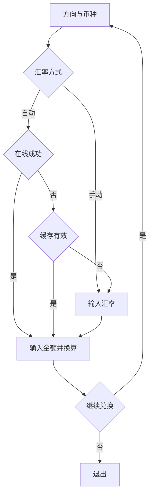
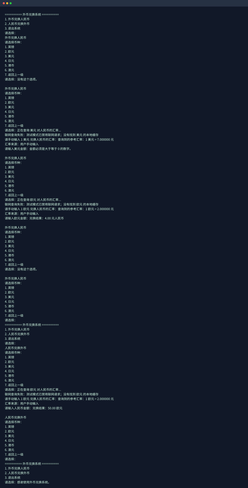
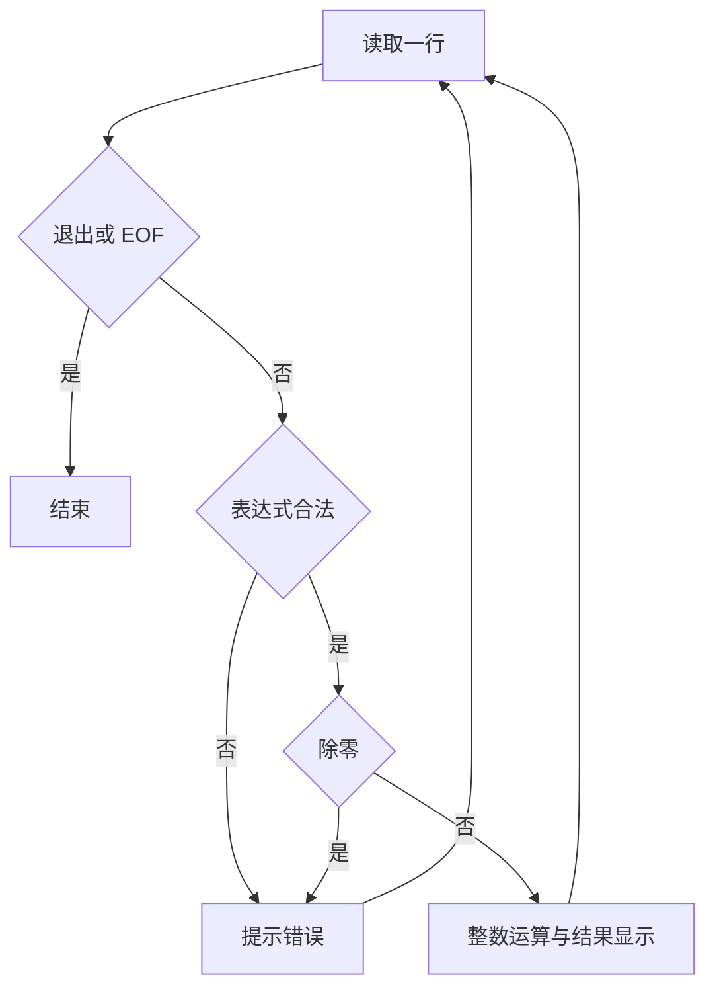
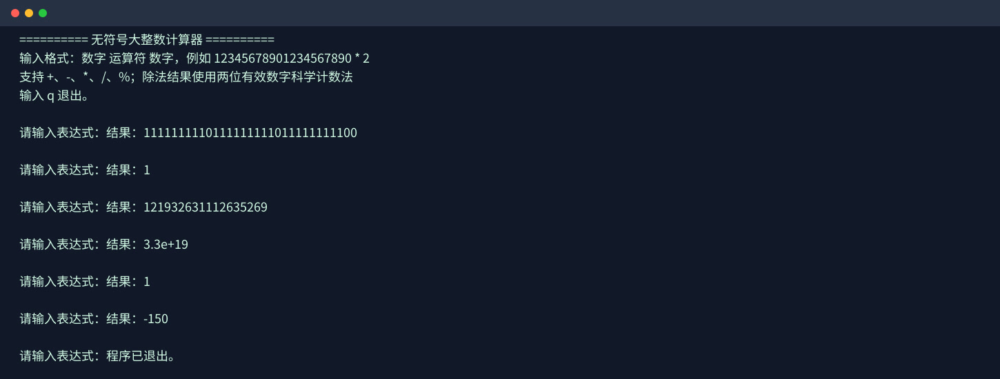
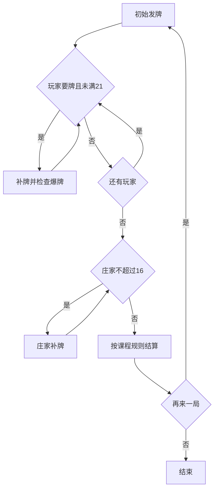
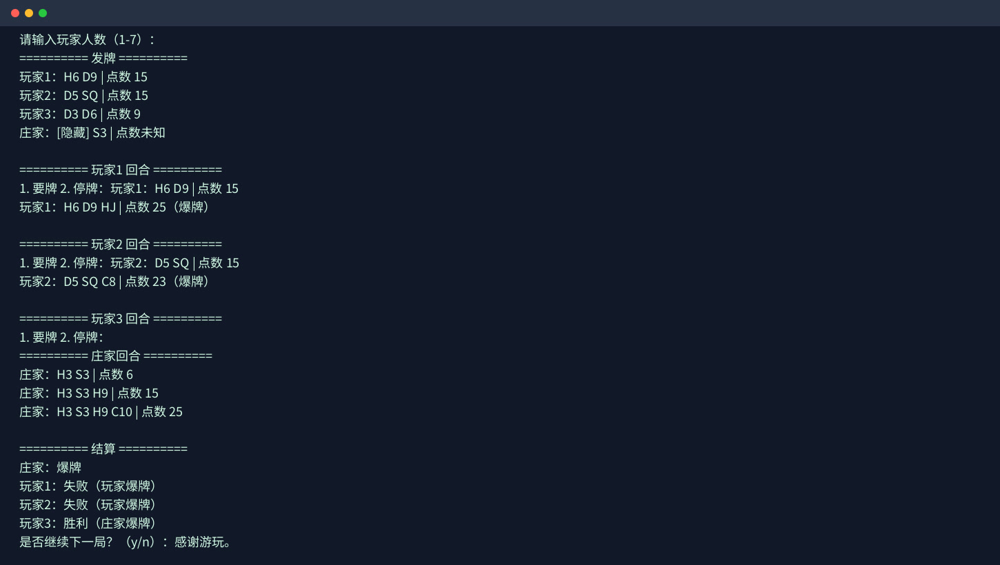
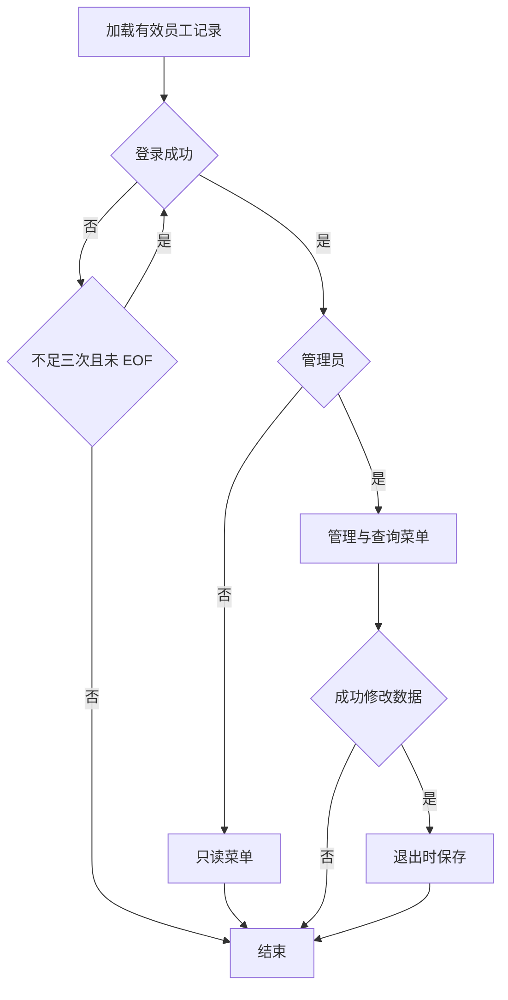
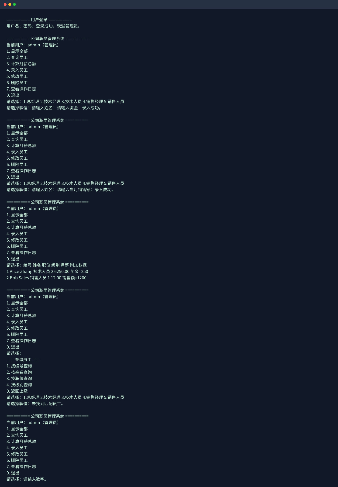

# C++ 程序设计综合项目实验报告


## 基本信息

| 项目 | 内容 |
|---|---|
| 课程 | C++ 程序设计 |
| 姓名 | 待填写 |
| 学号 | 待填写 |
| 学院 | 待填写 |
| 专业 | 待填写 |
| 指导教师 | 待填写 |
| 开发环境 | Linux / g++ / C++17 |

## 目录

1. [外币兑换系统](#第一章-外币兑换系统)
2. [无符号大整数计算器](#第二章-无符号大整数计算器)
3. [21 点纸牌游戏](#第三章-21-点纸牌游戏)
4. [公司职员管理系统](#第四章-公司职员管理系统)
5. [综合总结](#第五章-综合总结)

---

# 第一章 外币兑换系统

## 1.1 设计内容

### 1.1.1 功能概述与运行流程

程序启动后显示外币兑换主菜单，用户先选择“外币兑换人民币”或“人民币兑换外币”，再选择币种、汇率方式并输入金额。系统优先联网获取汇率；网络不可用时依次尝试有效缓存和手动输入。完成兑换后返回币种菜单，用户可以继续兑换、返回主菜单或选择退出。



### 1.1.2 项目概要

外币兑换系统位于 [`Currency_Exchange/currency_exchange.cpp`](./Currency_Exchange/currency_exchange.cpp)，用于完成外币与人民币之间的双向兑换。系统支持英镑、欧元、美元、日元、港币和澳元。

本项目不把汇率写死在业务代码中，而是优先通过命令行 `curl` 请求 `open.er-api.com`，获取指定外币兑换人民币的参考汇率。考虑到网络请求可能失败，程序设计了在线查询、本地缓存和用户手动输入的降级路径。

### 1.1.3 主要功能

1. 外币兑换人民币；
2. 人民币兑换外币；
3. 支持六种常见外币；
4. 自动模式在线查询参考汇率（不保证实时交易报价），也可主动选择手动输入；
5. 解析 JSON 文本中的 `CNY` 汇率字段；
6. 在线请求成功后写入本地缓存；
7. 本地缓存有效期为 24 小时，超过有效期或时间戳非法时拒绝使用，转为手动输入；
8. 网络不可用且缓存不存在或过期时，允许用户手动输入汇率；
9. 检查菜单、金额和汇率输入；
10. 处理网络错误、解析错误、缓存错误和输入流 EOF。

### 1.1.4 项目创新

#### （1）汇率来源抽象

程序定义了 `IRateProvider` 接口：

```cpp
class IRateProvider {
public:
    virtual ~IRateProvider() = default;
    virtual bool get(const Currency& currency,
                     RateResult& result,
                     string& error) = 0;
};
```

在线服务和文件缓存都实现同一个接口，使兑换逻辑不依赖具体数据来源。

#### （2）在线服务与本地缓存结合

程序成功获取在线汇率后写入 `exchange_rates.cache`。缓存记录包含：

```text
币种代码 汇率 Unix时间戳
```

这样可以在网络短暂不可用时继续完成兑换。

#### （3）缓存有效期控制

缓存不是永久有效。程序将当前时间与缓存时间戳进行比较，只有不超过 24 小时的缓存才可以使用。过期缓存会被拒绝，避免长期使用明显过时的汇率。

#### （4）三级降级策略

```text
在线 API
    ↓ 请求失败
24 小时内本地缓存
    ↓ 不存在或已过期
用户手动输入
```

这种设计将网络故障转换为明确的降级提示，用户仍可按课程要求输入汇率。

## 1.2 设计思路

### 1.2.1 整体架构

系统可以划分为四层：

```text
用户菜单层
    ↓
兑换业务层 ExchangeApplication
    ↓
汇率协调层 RateService
    ↓
数据提供层 OnlineRateProvider / FileRateCache
```

- `ExchangeApplication`：负责菜单、币种选择、金额输入和最终换算；
- `RateService`：协调在线查询和本地缓存；
- `OnlineRateProvider`：通过 `curl` 请求网络接口并解析返回文本；
- `FileRateCache`：读写本地汇率缓存；
- `IRateProvider`：统一数据提供者接口。

### 1.2.2 核心模块职责

#### `Currency`

保存货币代码和中文名称，例如：

```cpp
{"USD", "美元"}
```

#### `RateResult`

保存汇率和来源信息：

```cpp
struct RateResult {
    double rate = 0;
    string source;
};
```

#### `OnlineRateProvider`

完成以下工作：

1. 拼接 API 地址；
2. 启动 `curl`；
3. 收集命令输出；
4. 检查命令执行结果；
5. 使用正则表达式提取 `CNY` 数值字段（支持指数形式并检查数值后的分隔符）；
6. 检查汇率是否为有限正数。

程序还提供 `CURRENCY_EXCHANGE_OFFLINE=1` 环境变量，便于在不发起真实网络请求的情况下测试缓存和手动输入分支。

#### `FileRateCache`

负责：

- 读取缓存文件；
- 查找指定币种；
- 检查汇率数值；
- 判断 24 小时有效期；
- 写入最新缓存；
- 报告缓存文件写入失败。

#### `ExchangeApplication`

负责主菜单、币种菜单、兑换方向、自动/手动汇率选择和金额输入。手动模式直接输入汇率；自动模式优先在线查询，在线失败后才查缓存，缓存不可用再提示输入。业务计算规则为：

```text
外币 → 人民币：人民币金额 = 外币金额 × 汇率
人民币 → 外币：外币金额 = 人民币金额 ÷ 汇率
```

### 1.2.3 关键功能实现逻辑

#### 1.2.3.1 在线汇率获取

程序使用白名单中的货币代码拼接 URL：

```text
https://open.er-api.com/v6/latest/USD
```

返回内容中提取类似字段：

```json
"CNY": 6.689327
```

随后通过 `std::stod` 转换，并检查：

- 是否能够解析；
- 是否超出可处理范围；
- 是否为有限数；
- 是否大于 0。

#### 1.2.3.2 缓存有效期

缓存读取时，程序计算：

```text
当前时间 - 缓存时间
```

当差值超过 `24 * 60 * 60` 秒时，报告缓存过期，并继续进入手动输入路径，不询问是否继续使用旧缓存。恰好 24 小时仍有效；负时间戳和晚于当前时间的时间戳均被拒绝。坏格式记录按行跳过，后续有效记录仍可读取。缓存位于启动时的工作目录。

#### 1.2.3.3 输入流防御

菜单输入和金额输入都会检查 `std::cin` 状态。菜单与金额按完整数字 token 校验，拒绝 `1abc` 或整数菜单中的 `1.5`。普通非法输入会清除错误标志并清空当前行；如果检测到 EOF，则直接返回上一级或退出，避免无限输出“输入无效”。

## 1.3 程序开发效果演示

本报告截图均为仓库已有演示；修订后的新增提示与边界行为以源码、文字说明及回归测试为准。

### 1.3.1 在线查询

以下截图为原有运行演示，采用当时的参考汇率；本次修订后选择币种时会先显示“汇率方式：1. 自动查询（失败时手动输入） 2. 手动输入”。本次回归使用本地 curl 替身验证成功/失败分支，没有重新验证外网接口可用性。示例：

```text
正在查询 美元 对人民币的汇率...
查询到的参考汇率：1 美元 = 6.689327 元
汇率来源：在线 API
请输入美元金额：2
兑换结果：13.38 元人民币
```



### 1.3.2 缓存读取

关闭在线请求并使用有效缓存时：

```text
联网查询失败：测试模式已禁用联网请求；已切换到本地缓存（2026-10-22 11:27:44）
汇率来源：本地缓存（2026-10-22 11:27:44）
```

### 1.3.3 过期缓存

缓存超过 24 小时后：

```text
美元 的本地缓存已过期
请手动输入 1 美元 兑换人民币的汇率：
```

### 1.3.4 编译命令

```bash
cd Currency_Exchange
g++ -std=c++17 -Wall -Wextra -pedantic \
    currency_exchange.cpp -o currency_exchange
./currency_exchange
```

程序通过系统 `curl` 命令联网，不要求安装 `libcurl` 开发头文件。

## 1.4 总结分析

本系统在完成基本兑换功能的基础上，重点实践了接口抽象、组合关系、外部服务调用、缓存和容错设计。`IRateProvider` 使数据来源可替换，`RateService` 将在线请求与业务计算隔离，缓存有效期则避免了无限期使用旧数据。

当前系统仍有改进空间，例如可以进一步记录兑换历史、增加汇率变化趋势展示，或者将缓存文件格式升级为更严格的结构化格式。

---

# 第二章 无符号大整数计算器

## 2.1 设计内容

### 2.1.1 功能概述与运行流程

程序启动后显示输入格式，用户连续输入“数字 运算符 数字”形式的单个二元表达式。程序解析表达式并执行加、减、乘、除或余数运算，随后显示结果并等待下一条表达式；输入 `q` 或 `Q` 后退出。



### 2.1.2 项目概要

无符号大整数计算器位于 [`Unsigned_Big_Integer_Calculator/calculator.cpp`](./Unsigned_Big_Integer_Calculator/calculator.cpp)。程序使用字符串保存十进制数字，不依赖 C++ 内置整数类型，因此可以处理远超 `long long` 范围的数字。

程序将大整数封装在 `UnsignedBigInteger` 类中，实现加法、减法、乘法、精确整数除法、余数和科学计数法除法显示。

### 2.1.3 主要功能

1. 字符串形式输入无符号大整数；
2. 自动去除前导零；
3. 精确加法；
4. 精确减法；
5. 减法结果小于零时由界面显示负号；
6. 精确乘法；
7. 使用十进制长除法计算商；
8. 使用 `%` 计算余数；
9. `/` 以两位有效数字科学计数法显示；
10. 连续输入表达式；
11. 检查非法字符和除零。

### 2.1.4 项目创新

#### （1）突破内置整数位数限制

数字主体存储为：

```cpp
std::string digits_;
```

每个字符代表一个十进制数字，`std::string` 使用连续字符存储，各字符保存一位十进制数字，对应题目的字符数组表示思路；实际长度受内存、索引类型和算法运行时间限制。

#### （2）运算符重载

大整数支持类似内置数值类型的写法：

```cpp
left + right
left - right
left * right
left / right
left % right
```

这提高了核心类的可读性和复用性。

#### （3）精确长除法和余数

程序没有把整数除法直接转换为 `double`，而是实现逐位长除法，能够同时得到：

```text
整数商
余数
```

#### （4）近似显示与精确运算分离

`operator/` 和 `operator%` 负责精确整数运算；`scientificQuotient` 只负责将除法结果格式化为科学计数法。这种职责分离避免了显示需求污染核心整数算法。

## 2.2 设计思路

### 2.2.1 数据规范化

构造对象时检查每个字符是否为数字，并将全零数字统一成：

```text
0
```

例如：

```text
0000123 → 123
0000    → 0
```

### 2.2.2 加法

从最低位向最高位处理，保存进位：

```text
当前位 = 左数字 + 右数字 + 进位
结果位 = 当前位 % 10
新进位 = 当前位 / 10
```

时间复杂度为 `O(n)`。

### 2.2.3 减法

`subtract` 只处理较大数减较小数。每一位使用借位机制计算。界面层先比较两个操作数，决定是否输出负号。

### 2.2.4 乘法

乘法使用十进制数组保存每一位的中间结果，逐位相乘后统一处理进位。设两个数字长度分别为 `n` 和 `m`，基本时间复杂度为 `O(nm)`。

### 2.2.5 长除法

核心函数为：

```cpp
divideStrings(const UnsignedBigInteger& dividend,
              const UnsignedBigInteger& divisor)
```

算法流程：

1. 从被除数最高位开始逐位取数；
2. 将当前数字追加到余数末尾；
3. 尝试确定当前商位 `0` 到 `9`；
4. 从余数中减去除数乘当前商位；
5. 继续处理下一位；
6. 最后去除商的前导零。

### 2.2.6 科学计数法

科学计数法显示使用完整整数比较确定指数，再放大分子，使用长除法得到两位有效数字与余数。以余数的两倍是否大于等于分母执行四舍五入；舍入到 100 时，尾数改为 1.0 并将指数增加 1。全过程不转换为浮点数，避免截取前三位导致的错误。输出示例：

```text
100 / 3 → 3.3e+1
1 / 2000 → 5.0e-4
1999 / 1000 → 2.0e+0
9999 / 1000 → 1.0e+1
```

这里的 `3.3` 和 `5.0` 均包含两位有效数字。

## 2.3 程序开发效果演示

### 2.3.1 基本运算

```text
12345678901234567890 + 98765432109876543210
结果：111111111011111111100

1000 - 1234
结果：-234

99999999999999999999 * 99999999999999999999
结果：9999999999999999999800000000000000000001
```



### 2.3.2 长除法与余数

```text
12345678901234567890 / 1000
结果：1.2e+16

12345678901234567890 % 1000
结果：890

100 % 3
结果：1
```

### 2.3.3 异常输入

```text
10 / 0
错误：除数不能为零
```

### 2.3.4 编译命令

```bash
cd Unsigned_Big_Integer_Calculator
g++ -std=c++17 -Wall -Wextra -pedantic \
    calculator.cpp -o calculator
./calculator
```

## 2.4 总结分析

本项目将字符串处理、类封装、运算符重载和大数算法结合起来，重点解决了内置整数类型范围不足的问题。通过将精确整数运算与科学计数法显示分开，程序既满足了题目对除法显示形式的要求，也保留了 `/` 和 `%` 的精确结果能力。

目前表达式解析器支持单个二元运算，不支持括号和多运算符优先级。若继续扩展，可以实现递归下降解析器，使其支持 `(A+B)*C` 一类表达式。

---

# 第三章 21 点纸牌游戏

## 3.1 设计内容

### 3.1.1 功能概述与运行流程

程序启动后要求输入玩家人数（1 至 7 人），随后自动洗牌并为每位玩家和庄家发牌。玩家依次选择要牌或停牌，所有玩家回合结束后庄家按照点数规则自动补牌，最后显示每位玩家与庄家的胜负结果。用户可以选择开始下一局或退出。



### 3.1.2 项目概要

21 点游戏位于 [`Blackjack_Game/blackjack.cpp`](./Blackjack_Game/blackjack.cpp)。程序模拟庄家与 1 至 7 名玩家进行 21 点游戏的过程。

项目使用标准 52 张扑克牌，不加入大小王。数字牌按面值计算，J、Q、K 按 10 计算，A 根据当前手牌情况按 1 或 11 计算。

### 3.1.3 主要功能

1. 支持 1 至 7 名玩家；
2. 自动生成和洗牌；
3. 每局发牌前重新洗牌；
4. 庄家首张牌隐藏；
5. 玩家选择要牌或停牌；
6. 玩家点数超过 21 时判定爆牌；
7. A 根据是否爆牌动态按 1 或 11 计算；
8. 庄家点数小于等于 16 时自动要牌；
9. 庄家超过 21 时判定庄家爆牌；
10. 支持连续多局；
11. 支持输入错误和 EOF 退出。

## 3.2 设计思路

### 3.2.1 基础数据层

#### `Suit` 和 `Rank`

使用枚举表示花色和点数，避免直接使用难以理解的数字常量：

```cpp
enum class Suit { Hearts, Diamonds, Clubs, Spades };
enum class Rank { Two = 2, ..., King, Ace };
```

#### `Card`

`Card` 保存花色和点数，并提供：

- `value()`：得到牌面基础分值；
- `text()`：生成控制台显示文本。

#### `Deck`

`Deck` 负责：

- 创建 52 张牌；
- 使用 `std::mt19937` 随机引擎；
- 使用 `std::shuffle` 洗牌；
- 从牌堆末尾发牌；
- 牌堆为空时自动重新生成。

### 3.2.2 手牌与参与者层

#### `Hand`

`Hand` 保存牌组和爆牌状态，并实现 `score()`。计算过程先将 A 按 11 计入总分，如果总分超过 21，则依次将 A 从 11 降为 1。

例如：

```text
A + 5       = 16
A + 5 + K   = 16
A + A + 9   = 21
```

#### `Participant`

`Participant` 是参与者抽象类，统一保存姓名和手牌，并定义：

```cpp
virtual bool wantsCard() = 0;
```

#### `HumanPlayer`

玩家通过输入决定要牌或停牌。

#### `Dealer`

庄家根据规则自动决定：

```cpp
hand_.score() <= 16
```

时继续要牌，否则停牌。

### 3.2.3 牌局状态机

`BlackjackGame` 使用 `GameState` 表示牌局阶段：

```cpp
enum class GameState {
    Setup,
    Dealing,
    PlayerTurns,
    DealerTurn,
    Settlement,
    Finished
};
```

`transitionTo` 只在下列合法转移时更新状态：

```text
Setup → Dealing
Dealing → PlayerTurns
PlayerTurns → DealerTurn
DealerTurn → Settlement
Settlement → Finished
Finished → Dealing
```

当前状态机记录正常调用流程；非法转移不会更新状态，但该函数本身不阻止业务方法继续执行，不能视为完整的调用权限检查。

## 3.3 程序开发效果展示

### 3.3.1 发牌和玩家回合

示例：

```text
玩家1：S4 HK | 点数 14
庄家：[隐藏] C3 | 点数未知

========== 玩家1 回合 ==========
1. 要牌  2. 停牌：
```



### 3.3.2 庄家自动回合

玩家停牌后，庄家自动补牌直到点数大于 16：

```text
庄家：C6 C3 | 点数 9
庄家：C6 C3 SQ | 点数 19
```

### 3.3.3 结算

```text
========== 结算 ==========
庄家：19
玩家1：失败
```

结算按课程原文执行：庄家与玩家同时爆牌时平局；只有玩家爆牌时玩家失败；只有庄家爆牌时玩家获胜；其余按点数比较。这与部分通行 Blackjack 规则不同，以课程要求为准。

### 3.3.4 编译命令

```bash
cd Blackjack_Game
g++ -std=c++17 -Wall -Wextra -pedantic \
    blackjack.cpp -o blackjack
./blackjack
```

## 3.4 总结分析

本项目将现实中的扑克牌、手牌、玩家、庄家和牌局流程分别抽象为不同对象，实践了枚举、组合、继承、多态、智能指针和随机数引擎。A 的动态计分是规则实现的重点，状态转移控制则增强了牌局流程的可维护性。

当前版本没有实现下注、分牌、加倍、Blackjack 特殊赔率和固定种子命令行参数。后续可以在不改变基础牌局结构的情况下增加这些功能。

---

# 第四章 公司职员管理系统

## 4.1 设计内容

### 4.1.1 功能概述与运行流程

程序启动后先读取可执行文件目录下的员工数据，并显示登录界面。管理员登录后可以录入、显示、查询、修改、删除员工、统计工资和查看操作日志；普通用户只能显示、查询和统计工资。用户选择退出后，若发生了成功的数据修改，程序保存员工数据并结束运行。



系统当前使用预置账号：管理员 `admin/admin`，普通用户 `user/user`。连续三次登录失败后程序退出。

### 4.1.2 项目概要

公司职员管理系统位于 [`Employee_Management_System/employee_system.cpp`](./Employee_Management_System/employee_system.cpp)。系统针对总经理、技术经理、技术人员、销售经理和销售人员五类职位，使用继承和多态实现差异化工资计算。

系统支持员工录入、显示、查询、修改、删除、工资统计和文件持久化。

### 4.1.3 主要功能

1. 录入五类员工；
2. 自动分配连续编号；新对象初始 1 级，工厂创建后调用升级方法设置课程指定级别；
3. 显示编号、姓名、职位、级别、月薪和附加数据；
4. 支持中文和英文混排表格对齐；
5. 按编号查询；
6. 按姓名查询；
7. 按职位查询；
8. 按级别查询；
9. 修改技术人员或技术经理奖金；
10. 修改销售人员销售额；
11. 删除员工并重新编号；
12. 计算全体员工月薪总额；
13. 保存和恢复员工数据；
14. 支持包含空格的姓名；
15. 拒绝负数、NaN、无穷大和非法金额。

工资规则如下：

| 职位 | 月薪规则 |
|---|---|
| 总经理 | 固定 20000 元 |
| 技术经理 | 固定 12000 元 + 奖金 |
| 技术人员 | 固定 6000 元 + 奖金 |
| 销售经理 | 固定 8000 元 + 所有销售人员销售额的 5‰ |
| 销售人员 | 个人销售额的 1% |

## 4.2 设计思路

### 4.2.1 类层次结构

系统以 `Employee` 为抽象基类，定义：

```cpp
virtual std::string role() const = 0;
int level() const;
void promote();
virtual int targetLevel() const = 0;
virtual double salary(double departmentSales) const = 0;
virtual Role roleCode() const = 0;
```

派生结构如下：

```text
Employee
├── FixedEmployee
│   └── GeneralManager
├── BonusEmployee
│   ├── TechnicalManager
│   └── Technician
├── SalesEmployee
│   └── Salesperson
└── SalesManager
```

不同职位通过多态重写 `salary()` 和 `targetLevel()`，管理类不需要知道每个职位的具体工资公式。

### 4.2.2 工厂模式

职位由 `Role` 枚举表示：

```cpp
enum class Role {
    GeneralManager = 1,
    TechnicalManager,
    Technician,
    SalesManager,
    Salesperson
};
```

`EmployeeFactory::create()` 根据职位枚举创建具体对象。基类 `level_` 初始为 1，工厂随后统一调用 `promote()`：总经理升到 4 级，技术经理和销售经理升到 3 级，技术人员升到 2 级，销售人员保持 1 级。升级不另设菜单，也不改变工资公式。

### 4.2.3 工资计算

销售人员的销售额由 `extraValue()` 提供，系统累加所有销售人员销售额后传给销售经理：

```text
departmentSales = 所有销售人员销售额之和
```

销售经理月薪为：

```text
8000 + departmentSales × 0.005
```

### 4.2.4 数据持久化

数据根据启动路径 `argv[0]` 定位到程序目录下的 `employees.dat`。应使用 `./employee_system` 或带目录的相对/绝对路径启动；仅通过 PATH 中的裸命令启动时，当前实现不能保证定位到真实可执行文件目录。每一行使用带引号的姓名格式：

```text
职位编号 "姓名" 附加数值
```

例如：

```text
3 "Alice Smith" 1000
```

程序启动时逐行加载数据；检查职位、非空姓名、重名、尾随字段、有限非负金额，坏行警告并跳过，继续读取后续行。成功新增、修改或删除后才在退出时保存；只读或登录失败不会重写数据文件。金额输入中途遇到 EOF 会取消尚未完成的新增/修改。

### 4.2.5 登录与权限控制

程序启动后需要先登录。管理员账号为 `admin/admin`，可以执行员工录入、显示、查询、修改、删除、工资统计和日志查看；普通用户账号为 `user/user`，只能显示、查询和统计工资，不能修改员工数据。连续三次登录失败后程序会退出。

菜单根据当前用户身份动态显示，业务操作中还会再次检查权限，避免普通用户通过直接输入管理员菜单编号执行写操作。

### 4.2.6 操作日志

系统将登录结果、新增员工、修改员工和删除员工等事件追加写入可执行文件目录下的 `employee_operations.log`。日志包含时间、用户名、操作类型、员工编号和姓名，但不记录密码。管理员可以通过“查看操作日志”菜单检查操作记录。

### 4.2.7 中文表格对齐

终端通常会把中文字符显示为两个等宽字符，但 `std::string::length()` 返回的是 UTF-8 字节数量。因此程序使用 `displayWidth()` 估算中文显示宽度，再通过 `printCell()` 填充空格，使中英文混排时的列仍然对齐。

## 4.3 效果演示

### 4.3.1 员工列表

```text
编号    姓名          职位            级别    月薪          附加数据
1       Mattea        总经理          4       20000.00
2       Matthew       总经理          4       20000.00
3       Max           技术经理        3       12200.00      奖金=200
4       Matte         技术人员        2       6200.00       奖金=200
```



### 4.3.2 查询菜单

```text
----- 查询员工 -----
1. 按编号查询
2. 按姓名查询
3. 按职位查询
4. 按级别查询
0. 返回上级
```

### 4.3.3 登录、权限与日志

系统启动时先进行身份认证。管理员登录后可以使用完整菜单，普通用户的菜单只保留显示、查询和工资统计功能。管理员完成员工新增、修改、删除后，可以在“查看操作日志”中看到带时间和用户名的审计记录；密码不会写入日志。

示例账号：

```text
管理员：admin / admin
普通用户：user / user
```

截图中的管理员流程包含员工录入、员工查询、员工列表显示和操作菜单，能够体现权限控制与持久化管理功能。

### 4.3.4 持久化恢复

首次运行录入员工后退出，再次从其他目录启动，程序仍能读取可执行文件目录中的 `employees.dat`，姓名中的空格也会保留。

### 4.3.5 编译命令

```bash
cd Employee_Management_System
g++ -std=c++17 -Wall -Wextra -pedantic \
    employee_system.cpp -o employee_system
./employee_system
```

## 4.4 总结分析

本系统综合运用了抽象类、继承、多态、工厂模式、`unique_ptr`、文件流、枚举和 STL 算法。工资计算被封装在具体职位类中，员工管理类只负责组织业务流程，减少了职位规则之间的耦合。

当前版本的数据文件是轻量级文本格式，适合课程作业和单机使用。若用于更大的实际系统，还可以进一步增加事务式保存、密码哈希、账号持久化和数据库存储。

---

# 第五章 综合总结

## 5.1 项目总体特点

四个题目分别覆盖了网络服务、缓存、字符串算法、面向对象游戏建模、状态机、多态和文件持久化：

| 题目 | 主要技术 |
|---|---|
| 外币兑换系统 | 接口抽象、网络请求、正则解析、缓存、降级策略 |
| 无符号大整数计算器 | 字符串大数、运算符重载、长除法、余数 |
| 21 点纸牌游戏 | 枚举、随机数、组合、继承、多态、状态机 |
| 公司职员管理系统 | 抽象基类、工厂模式、智能指针、文件持久化、权限控制、操作日志 |

## 5.2 工程化实践

项目统一使用以下编译参数：

```bash
-std=c++17 -Wall -Wextra -pedantic
```

这些参数能够启用较新的 C++ 语言特性，并尽早发现潜在问题。四个项目目录均采用下划线命名：

```text
Currency_Exchange
Unsigned_Big_Integer_Calculator
Blackjack_Game
Employee_Management_System
```

课程要求以 VS 为主。本次编译验证使用 Linux / g++；Windows MSVC 的使用命令见根目录 README，但尚未在真实 MSVC 环境运行验证。

## 5.3 测试情况

本次修订执行 `python3 tests/run_tests.py`，共 560 项检查通过。脚本在临时目录构建与运行，不写入项目数据：

- 四个项目的 C++17 编译，启用 `-Wall -Wextra -pedantic`，未出现编译警告；
- 100 组随机大整数的加、减、乘、除、余数，以 Python 整数和高精度 Decimal 作参考；另外覆盖前导零、非法表达式、除零、舍入进位；
- 外币有效缓存、有效期前后、未来时间戳、坏格式记录、缺失缓存、自动失败转手动、主动手动与反向兑换、乘法溢出、各输入阶段 EOF；
- 通过本地 curl 替身验证正数、指数、负数、坏格式、缺失字段与超范围返回，检查仅成功查询才写缓存，保留小汇率精度；
- 21 点 A 的动态计分、庄家 16/17 点要牌边界、普通胜负、平局、双方爆牌与 EOF；确定性对象测试与随机交互分开；
- 员工五类工资、初始级别及升级、空格姓名、负奖金重输、中断新增取消、工资汇总、权限拒绝、姓名查询、重启恢复、坏行后继续加载、三次登录失败，以及只读会话不重写数据。

测试未覆盖真实外网 API、真实 Windows/MSVC、所有终端的中文显示效果和文件系统故障注入。旧截图仅为已有演示，不能替代本次自动化结果。逐项课程要求核对见 [审查记录](./REVIEW.md)。

## 5.4 不足与改进方向

1. 外币系统目前使用系统 `curl` 和文本正则解析返回内容，其解析并非完整 JSON 校验，未来可以使用专门 JSON 解析库；
2. 汇率数据目前按单币种保存，未来可以增加历史汇率趋势；
3. 大整数表达式暂时是单个二元运算，未来可以支持括号和运算符优先级；
4. 21 点尚未实现下注、分牌、加倍和 Blackjack 特殊赔率；
5. 员工系统已经加入管理员/普通用户权限和操作日志，未来可以进一步迁移到数据库并增加密码哈希；
6. 当前程序主要面向控制台，未来可以增加图形界面，但需要引入额外依赖。

## 5.5 结论

本项目没有停留在四个孤立的功能演示，而是分别在四个题目中实践了不同的 C++ 设计和工程方法。外币系统体现了外部服务不可靠条件下的缓存与降级；大整数计算器体现了数据表示和基础算法设计；21 点游戏体现了对象建模与状态控制；员工系统体现了多态、工厂和持久化。

通过这些实现，项目覆盖了从输入处理、核心算法、对象设计到外部数据和文件存储的完整开发流程。
